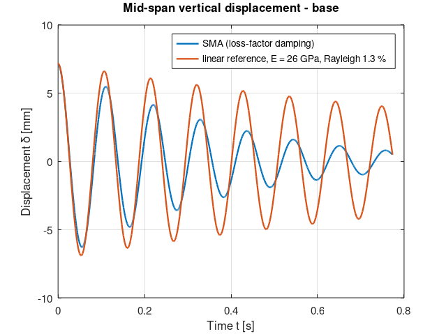
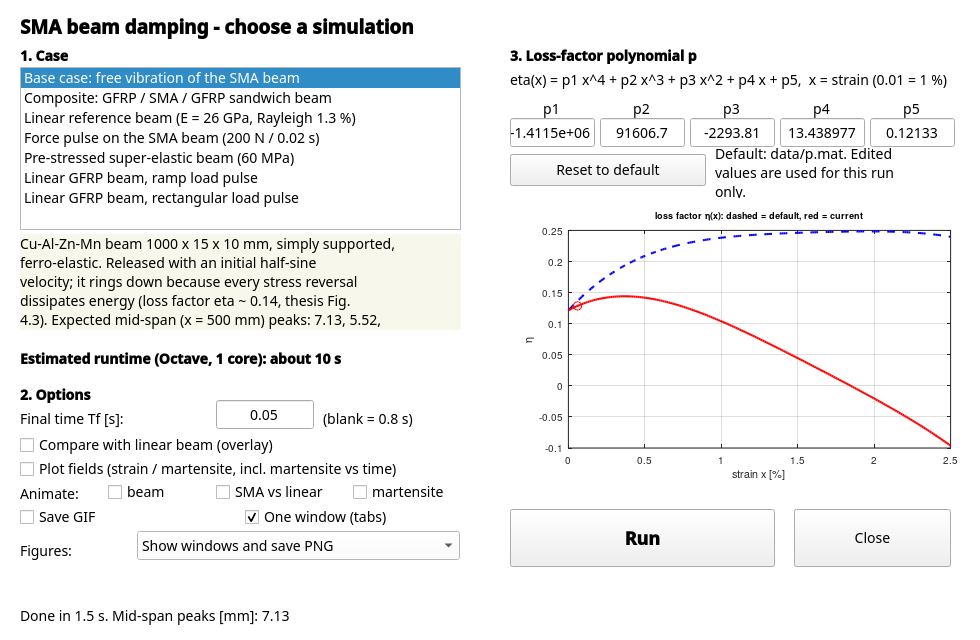
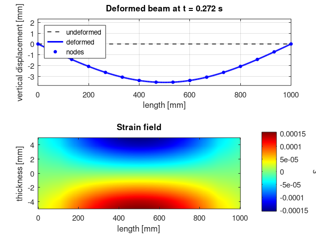
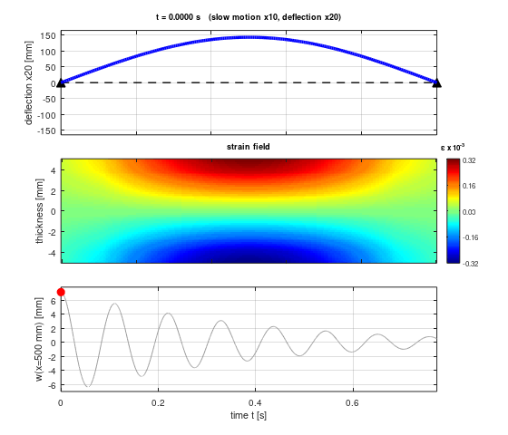
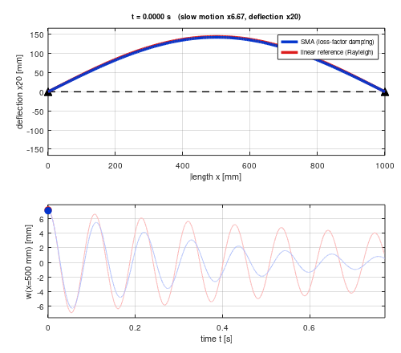
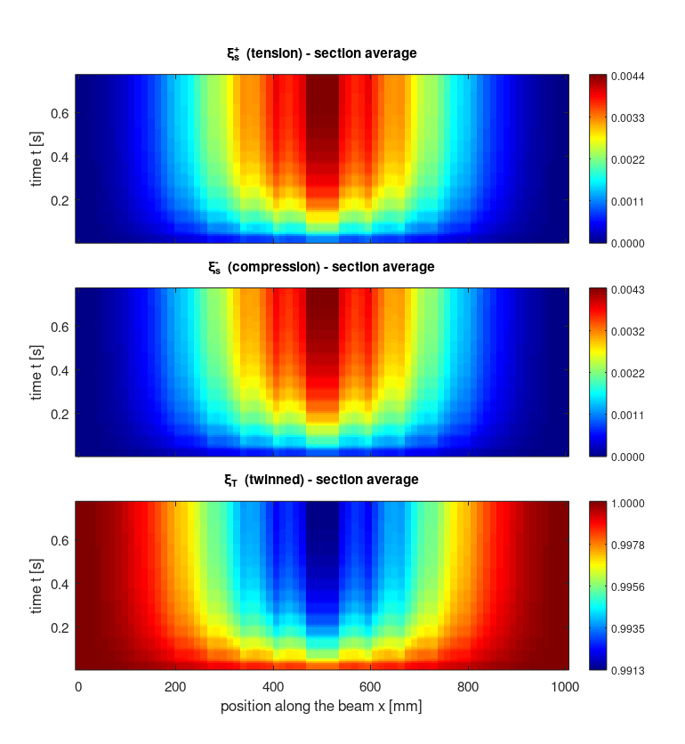
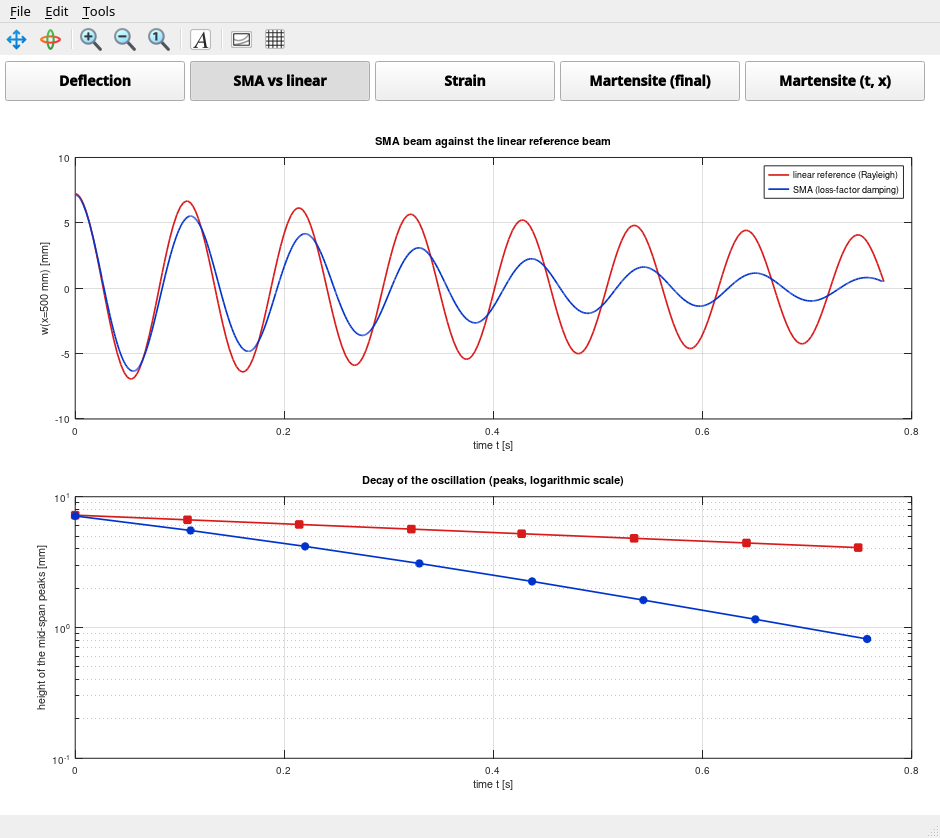
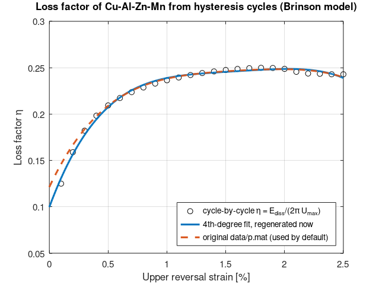

# sma-beam-damping

Finite-element simulation of the **vibration and damping of a shape-memory-alloy (SMA) beam**,
written in MATLAB for a master's thesis and cleaned up here so that it runs in **GNU Octave**
(and still in MATLAB).

> Federico Aghito, *Theoretical and numerical modeling of Shape Memory Alloy based structures and
> analysis of the dynamical properties*, Laurea Magistrale in Ingegneria Meccanica, Scuola di
> Ingegneria Industriale e dell'Informazione, academic year 2019/2020.



*Free vibration of the SMA beam (blue) against a linear beam of the same stiffness with 1.3 %
Rayleigh damping (orange): the SMA rings down much faster, because every stress reversal dissipates
energy in the martensite re-orientation.*

## What it does, in plain words

* **The beam.** A 1000 mm long, simply supported beam, modelled with the **Euler-Bernoulli** beam
  theory and finite elements: **15 elements** (16 nodes, 30 free degrees of freedom), each with
  deflection and rotation at its two ends. The beam section is cut into 10 layers and every element
  into 5 sections, so the material law is evaluated at **750 integration points**.
* **The material.** A Cu-Al-Zn-Mn shape-memory alloy, described by an **improved Brinson model**
  (Brinson 1993, with the improvement by Poorasadion et al.). Each point has a stress, a strain and
  three martensite fractions (tension-detwinned, compression-detwinned, twinned). While the stress
  moves through the critical range the fractions change with a cosine law and the stiffness
  changes with them.
* **The damping.** An SMA dissipates energy when it re-orients martensite. The model measures this
  with the **loss factor**

  eta = E_diss / (2 pi U_max)

  (dissipated energy per cycle divided by 2 pi times the maximum stored elastic energy). eta
  depends on the strain amplitude and is fitted once from Brinson cycles (a 4th-degree
  polynomial `p`, `brinson/Tension_compression_parametric.m`, shipped as `data/p.mat`). In the beam
  the damping matrix is then updated at every stress reversal:

  C = (eta / omega) K,   omega = 2 pi f_ref

  and the beam equations M a + C v + K u = F are integrated in time (`ode23t`).
* **Cases.** Free vibration of the SMA beam (the base case), the same compared with a linear
  reference, a **GFRP / SMA / GFRP sandwich** beam, a forced pulse, and a pre-stressed super-elastic
  beam. Each case is a small parameter file in `cases/`.

## How to run (GNU Octave or MATLAB)

```octave
cd sma-beam-damping
setup_paths          % once per session: puts the folders on the path
run_case             % opens the start window: choose the case, change p, tick the options, Run
```

`run_case` with no arguments (or `sma_gui`) opens a start window, so you never have to type the case name:



* **Case list** with a description and the estimated runtime of each case. A case whose estimate
  exceeds ~20 min would be flagged in red and ask for confirmation before it starts (none at the moment, thanks to the
  fast code path; with a long `Tf` the estimate scales and the warning can still appear).
* **Loss-factor coefficients p1..p5** (eta = p1 x^4 + ... + p5, x = strain as a fraction, 0.01 = 1 %), pre-filled from the
  case's own file (`data/p.mat`, or `data/p_SE.mat` for the super-elastic case). Edit any of them and the
  small plot shows the default curve (dashed) against yours (red); **Reset to default** brings them back.
  A changed `p` is used **for that run only**: `data/p.mat` is never overwritten, and the output files
  get the suffix `_pmod` (e.g. `results/base_pmod_midspan.png`) so the default-p files stay untouched.
  The fields are disabled for the linear cases (no loss factor there).
* **Final time Tf** (blank = the case default), **Compare with linear beam** (overlays the linear
  reference), **Plot fields** (strain / martensite fraction over the beam, and martensite versus time),
  **Animate** (beam / SMA vs linear / martensite) with **Save GIF**, **One window (tabs)** (the result plots in a
  single dashboard window; untick for separate windows) and **Figures** (show and save PNG / show only /
  save only / none).
* **Run** starts the simulation (the command window shows the progress); afterwards the results window
  (dashboard, see below) opens, and the status line lists the first ring-down peaks. Inputs are checked
  (numbers, Tf > 0) with a message that says what is wrong. Without a display (e.g. over ssh) a
  text menu is shown instead.

The scripting interface is unchanged and handy for batch jobs:

```octave
run_case('base')                    % ~10 s: free vibration, prints the ring-down peaks, saves a figure
run_case('base','compare_hle',true) % ... and overlays the linear reference (the figure above)
run_case('composite')               % ~2 s: GFRP/SMA/GFRP sandwich
run_case('base','Tf',0.1)           % quick look: shorten the duration
run_case('base','figures','both')   % show the plot windows AND save the PNG ('save' is the default)
run_case('base','p',[p1 p2 p3 p4 p5])   % own loss-factor coefficients for this run only
```

By default the scripted form only **saves** the figures to `results/` (git-ignored); use
`'figures','show'` or `'both'` to see them on screen. Octave needs no extra packages (tested with
GNU Octave 10.3).

*Octave note.* Octave has no `ode23t`; `compat/octave/ode23t.m` is a stand-in that forwards to
`ode23s` (a stiff Rosenbrock solver). It is only put on the path under Octave. The results are
visually the same as in MATLAB but not bit-identical.

## The cases

| `run_case(...)` | What | Runtime in Octave (1 core) |
|---|---|---|
| `'base'` | Free vibration, SMA beam 15 x 10 mm, ferro-elastic (below Mf), loss-factor damping | ~10 s (9 s measured, 5100 steps; 433 s without the fast code path) |
| `'hle_linear'` | Linear reference beam, E = 26 GPa, Rayleigh 1.3 % | 2 s |
| `'composite'` | GFRP / SMA / GFRP sandwich, free vibration | ~2 s (1.5 s measured; 53 s without the fast code path) |
| `'linear_pulse_incremental'`, `'linear_pulse_rectangular'` | Linear GFRP beam under a ramp / rectangular load pulse | 17 s |
| `'pulse'` | Rectangular 200 N / 0.02 s pulse on the 30 x 20 mm SMA beam | ~2 min (112 s measured, 64000 steps; hours without the fast code path) |
| `'prestrain_se'` | Super-elastic beam with 60 MPa pre-stress | ~45 s (41 s measured, 20800 steps; hours without the fast code path) |

Timings: GNU Octave 10.3 on a Linux box, 1 core; a laptop will differ. The fast code path
(`PERF_NOTES.md`: vectorised assembly, analytic Jacobian, no per-step history; same solver, same
tolerances, same physics) made `pulse` and `prestrain_se` practical. The shortened runs equal the
original scripts to a relative 1e-5 (`tests/run_tests.m`). **Results match to rounding level**: same step
counts and peaks to 1e-9 in the short runs, and at most **0.15 %** peak difference in the full base
run (a single restart can flip with round-off). The super-elastic case is more sensitive: its late
peaks (after ~0.3 s) move by a few percent under any round-off-level perturbation or change of
`RelTol`/`AbsTol`, see `PERF_NOTES.md`. The full-length old-code runs of `pulse` and `prestrain_se`
were not completed (too slow), so those two were compared with the old code only on shortened runs.

### Expected output of the base case

The mid-span deflection (at exactly x = L/2 = 500 mm, see below) rings down like this (peak heights, time axis
starting at the first maximum):

| peak | 1 | 2 | 3 | 4 | 5 | 6 |
|---|---|---|---|---|---|---|
| t [s] | 0 | 0.110 | 0.220 | 0.329 | 0.437 | 0.543 |
| height [mm] | 7.13 | 5.52 | 4.17 | 3.09 | 2.25 | 1.62 |

(The ratio of successive peaks, ~0.76, is what the loss factor controls; peaks 2-6 are the
values of thesis Fig. 4.3: about 5.5, 4.15, 3.1, 2.2, 1.6 mm.)

*Which point is "mid-span"?* With N = 16 nodes (15 elements) there is no node at x = L/2: the nodes 8 and 9 sit at
x = 467 and 533 mm. Earlier versions reported the deflection of node 9 (x = 533 mm). `res.midspan`
is the deflection at exactly x = 500 mm, obtained with the cubic Hermite shape functions of the beam element from
w and theta of nodes 8 and 9 (`src/midspan_deflection.m`); for mode 1 it is 0.56 % larger. The old node value is
kept as `res.midspan_node` (position `res.x_midspan_node` = 533 mm, column `res.col` of `res.XX`). The node-9 peaks
were 7.09, 5.49, 4.15, 3.07, 2.24, 1.61 mm. (The force of the `pulse` cases is still applied symmetrically around node 9,
see `KNOWN_ISSUES.md` #9.)

The sandwich beam (`run_case('composite')`, GFRP skins around the SMA core) rings down more slowly
than the pure SMA beam (the SMA is only part of the structure): peaks 7.09, 6.28, 5.53, 4.84, 4.21, 3.65 mm (node-9 values: 7.05, 6.25, 5.50, 4.81, 4.19, 3.63)
(`docs/composite_midspan.png`).

The fields at the last time step can be plotted with
`run_case('base','Tf',0.3,'plot_fields',true)` (or the "Plot fields" box of the start window). Two figures
come out: the martensite fractions over length x thickness (`results/<case>_fields.png`,
`docs/fields_example.png`) and the thesis-style picture of the deformed beam with the strain map
(`results/<case>_strain.png`, `docs/strain_example.png`).



### Animation of the vibration (and GIF export)

After a run the beam vibration can be played, or written to an animated GIF:

```octave
run_case('base','animate','gif')        % results/base_animation.gif (no window)
run_case('base','animate',true)         % play in a window
run_case('base','animate','both','animate_opts',{'speed',0.05,'exaggeration',50})
```

or tick **Animate beam** / **Save GIF** in the start window. `src/animate_beam.m` shows, in slow motion (default 0.1x real
time, 20-25 frames per second, resampled uniformly from the solver's non-uniform steps), the deflected beam (cubic Hermite
shape of the FE model, deflection exaggerated by the factor printed in the label, undeformed axis dashed), the strain field over
length x thickness (colour limits fixed over the whole run; computed from the nodal dofs, so no field history is needed, it also
works for the linear cases) and the mid-span time history with a moving marker. Options: `fps`, `speed`, `exaggeration`,
`strain`, `history`, `tspan`, `size`, `still` (PNG of one frame); see `help animate_beam`. Runtime is a few seconds for the full base case
(about 5 s for the 155 frames of the sample; the simulation itself takes longer).



*Full 0.8 s base case, 10x slow motion, deflection x20 (`docs/base_animation.gif`, 2.6 MB; still frame: `docs/base_animation_frame.png`).*

The GIF writer is pure Octave/MATLAB (`imwrite(...,'gif','DelayTime',...,'LoopCount',Inf)`, one common 256-colour palette),
no external tool needed. Octave needs the GraphicsMagick-enabled `imwrite` (the Windows installer has it; Octave prints a harmless
"limits images to 8 bits per pixel" warning) - the code asks for LZW compression, without which Octave's GIFs are ~10x larger.

### Looping GIFs, SMA vs linear, martensite evolution and the dashboard

```octave
run_case('base','animate_compare','gif')              % results/base_animation_compare.gif: SMA beam and linear beam together
run_case('base','animate_fields','gif')               % results/base_fields_animation.gif: martensite fractions over time
run_case('base','plot_fields',true)                   % + results/base_martensite_xt.png (martensite versus time and position)
run_case('base','compare_hle',true,'plot_fields',true,'figures','both')   % one dashboard window with tabs, PNGs saved too
run_case('base','figures','show','dashboard',false)   % the old separate windows
```

* **GIFs loop forever.** Every GIF written by the code (`src/gif_write.m`) carries the NETSCAPE loop block; if the image
  library leaves it out, `gif_ensure_loop` inserts it. (Some viewers, e.g. the Windows photo viewer, ignore the loop setting
  and show a GIF once; browsers, GitHub, PowerPoint and VLC loop it.)
* **SMA vs linear beam** (`'animate_compare'`, `src/animate_compare.m`): both beams overlaid on the same axes with the same
  deflection scale (SMA blue, linear reference red) and both mid-span time histories with a moving marker each. It runs the
  linear reference (`hle_linear`) itself if `compare_hle` is not set. Values for `'animate_compare'`: `true` (window), `'gif'`, `'both'`.



*10x slow motion, deflection x20; the linear beam (red) decays much more slowly than the SMA beam (blue) (`docs/base_animation_compare.gif`, 2.1 MB).*

* **Martensite evolution.** The martensite fractions depend on the load history (hysteresis), so they cannot be rebuilt from
  the displacements afterwards; `sma_beam_solve` therefore copies xi_s+, xi_s-, xi_T at ~100 evenly spaced times while it
  solves (`cfg.post.n_snapshots`, `res.snapshots`; 750 x 3 numbers each, no measurable cost, the solution is bit-identical,
  and the `cfg.perf` flags still work). `plot_fields` and `animate_fields` switch it on. It works for the base and the composite
  case; the super-elastic pre-strain case has one fraction (xi_s+).
  * `'plot_fields',true` also saves `results/<case>_martensite_xt.png` (`src/martensite_xt.m`): one colour map per fraction,
    position along the beam horizontally, time vertically, averaged over the section thickness (`martensite_xt(res,cfg,fig,'fibre','top')`
    for an outer fibre, also `'bottom'`, `'max'`).
  * `'animate_fields'` (`true`, `'gif'`, `'both'`; `src/animate_fields.m`) animates the three maps of the final-time figure over
    length x thickness with fixed colour limits and the mid-span history below (extra options in `'fields_opts'`, e.g.
    `{'step',2}` for fewer frames; `docs/base_fields_animation.gif`).



*Base case: the martensite fractions accumulate where the strain is largest (mid-span), cycle after cycle.*

* **Dashboard** (`src/dashboard.m`). With `'figures'` = `'show'` or `'both'` (and in the start window) the plots are collected in
  one window with a row of tab buttons: Deflection, SMA vs linear (with `compare_hle`), Strain and Martensite (final) (with `plot_fields`,
  two-phase models), Martensite (t, x). The PNG files are written exactly as before. GNU Octave 10.3 has no `uitabgroup`, so the tabs are
  toggle buttons that switch `uipanel`s, which works in the Octave Qt toolkit and in MATLAB; with the gnuplot / FLTK toolkits `run_case`
  falls back to separate windows (`'dashboard',false` forces them). Animations open in their own windows.





*Loss factor eta versus reversal strain computed from Brinson cycles, and its polynomial fit.*

## Folder structure

```
run_case.m              the one entry point: run_case (window) or run_case('base') ...
sma_gui.m               the start window (uicontrol only; Octave Qt and MATLAB) + text fallback
setup_paths.m           adds the folders to the path (called by run_case)
cases/                  one parameter file per case (case_base.m ...) + default_config.m listing EVERY parameter
src/                    the solver
  sma_beam_solve.m      nonlinear (loss-factor) beam solver   [was Loss/FEM1D.m and its 5 copies]
  myfun.m               OutputFcn: strain -> Newton on stress/martensite -> tangent K -> damping C
  myfun_SE.m            the same for the super-elastic, pre-stressed case
  build_beam.m          FEM matrices (mass, stiffness, extraction, B matrices)
  fun_ode_1D.m          right-hand side of the ODE
  linear_beam_solve.m   linear beam with Rayleigh damping (reference and linear pulses)
  composite_matrices.m  matrices of the GFRP skins (was Composite_matrices.m + hand-saved Matrices.mat)
  initial_velocity.m    initial half-sine velocity field
  meshare.m             field plots (optional)
  animate_beam.m, animate_compare.m, animate_fields.m   animations (+ gif_write.m, gif_ensure_loop.m ... GIF helpers)
  martensite_xt.m, dashboard.m   martensite versus time and position; the tabbed results window
  smooth_mean2d.m       moving-average smoothing used by meshare.m
  case_catalog.m        list of cases with descriptions, runtime estimates, p file (feeds the window)
brinson/                material level (thesis chapter 2): Brinson model, phase diagram, super-elasticity,
                        Tension_compression_parametric.m (the loss-factor fit), Brinson_validation.m ...
data/                   p.mat (loss-factor polynomial, original), p_SE.mat (super-elastic one)
compat/octave/          ode23t stand-in for Octave
tests/                  run_tests.m: refactored code vs the original 2020 scripts; test_gui.m: the start window
tools/                  make_loss_factor_figure.m
LICENSE                 MIT
docs/                   figures; CODE_MAP_original_analysis.md = the original code map (before the cleanup)
archive/                older attempts (not maintained), see archive/README.md
CHANGES.md              what differs from the original thesis code (kept / moved / removed / changed) and the verification
KNOWN_ISSUES.md         bugs and oddities of the original code
```

## Using your own parameters

Every simulation is described by one struct (see `cases/default_config.m`; the fields that a
menu would fill are marked `[MENU]`):

```octave
cfg = case_base();
cfg.time.Tf = 0.3;                  % duration [s]
cfg.init.scale = 0.3;               % smaller initial velocity -> smaller vibration
cfg.damping.f_ref = 12;             % reference frequency [Hz]
res = run_case(cfg);                % run_case also accepts a struct
```

A force pulse: `cfg = case_pulse(); cfg.load.F_element = -50;` (nodal force per mid-span element, N).

To regenerate the loss-factor curve instead of using the shipped one:
`run('brinson/Tension_compression_parametric.m')` writes `results/p_regen.mat`, then
`cfg.p_file = fullfile('results','p_regen.mat')`. This is an alternative only: the default stays the original
`data/p.mat`, which matches the thesis best (the regenerated curve is lower at small strain, see
`CHANGES.md` and `docs/loss_factor_fit.png`).

## Tests

```octave
cd tests; run_tests            % quick (~2.5 min): short runs of every case equal to the original scripts within a relative 1e-5 (round-off)
run_tests('full')              % + the full base and composite runs, peaks versus the thesis
```

`run_tests` also covers the looping GIFs, the martensite snapshots, the xt map, the fields and comparison animations and the dashboard.

The start window has its own automatic test (it opens the window, sets values programmatically and
presses Run with a short `Tf`; needs a display, on Linux `xvfb-run -a octave --no-gui --eval "cd tests; test_gui"`).

## Known limitations

* Only the thesis geometry (N = 16 nodes) is verified. Other `N` should work in principle but are untested.
* The model is **one-dimensional** in the material (Brinson): good for beams loaded along their axis;
  not a 3D constitutive law.
* The results depend on the ODE tolerance (the ring-down of the base case is ~2 % higher with `RelTol` 1e-5 than with the default 1e-3; the super-elastic case is more sensitive), because stress reversals are detected on the solver's step grid. See `PERF_NOTES.md`.
* The start window is busy while a simulation runs (progress is printed in the command window; Ctrl+C
  stops a run). It is built from plain `uicontrol`s, so its look varies a little between Octave on
  Windows/Linux and MATLAB; tested headless under GNU Octave 10.3 (Qt) on Linux only.
* The `ode23t` stand-in is not the same integrator as MATLAB's, so the numbers differ slightly from
  a MATLAB run (a MATLAB run of the original code was not available).
* The Newton loop of the 2020 code used `&&` where `||` was almost certainly intended; the cleaned code uses `||`
  (effect on the results < 1 %, see `KNOWN_ISSUES.md` #1 and `CHANGES.md`). Several smaller issues of the original are listed there too.
* The force term of the linear transient case was lost in the original files and is inferred.

## Roadmap

1. ~~Interactive menu~~ **done**: `run_case` opens a start window (case, p coefficients, linear comparison, Tf, figures). Still open: load type / force / frequency fields, and a low-resolution quick mode.
2. ~~Post-run beam animation~~ **done** (beam, SMA vs linear, martensite fractions; looping GIFs; results dashboard).
3. Forced vibration and frequency response in the start window.
4. Design charts: how much SMA is needed for a given damping.
5. Other shapes and boundary conditions; comparison against real tests; other constitutive models.
6. **Someday**: a 3D beam (2 -> 6 degrees of freedom per node) needs a 3D constitutive law such as
   Lagoudas or Souza-Auricchio with its own return-mapping solver. Keeping Brinson and adding bending
   in two directions is a possible intermediate step.

## Related work

* Helbert et al. (2021), *On the understanding of damping capacity in shape memory alloys* -
  energy-based loss factors compared with the damping measured on vibrating SMA beams.
  <https://doi.org/10.1177/1045389X20974453>
* Khalili et al. (2013), *Transient dynamic analysis of pseudoelastic SMA hybrid composite beam* -
  Euler-Bernoulli beam with the Brinson model, in MATLAB; the closest methodological relative.
  <https://doi.org/10.1016/j.amc.2013.03.092>
* Saedi et al. (2023), *Energy damping in shape memory alloys* (review; material side).
  <https://doi.org/10.1016/j.jallcom.2023.170286>
* Tabrizikahou et al. (2022), *Shape memory alloys for structural vibration control* (modelling and large structures).
  <https://doi.org/10.1016/j.conbuildmat.2022.127975>

## Licence

MIT, see `LICENSE` (Copyright (c) 2026 Federico Aghito). The code contains no third-party code
(the optional field plots use an own moving-average, `src/smooth_mean2d.m`).
