# CODE MAP — Master thesis MATLAB code (2020)

Thesis: numerical simulation of the vibration of a Shape-Memory-Alloy (SMA) beam and of the damping that the SMA phase transformation provides (Cu-Al-Zn-Mn, after Poorasadion et al.).
Source: Drive folder `1tNZ94ASA0bV1-cgvYCok_tvQ9dcluhTV` (read-only; nothing was modified there).
Local copy: `/workspace/thesis-code/`.

How this map was made: every `.m` file was read, `.mat` variable names/sizes were read with scipy, and `.fig` titles/labels were read from the files. MATLAB was **not** run. Anything not directly visible in code or thesis is marked **unclear**. "Thesis §" refers to the thesis PDF.

Size of the picture: 214 files on Drive (about 996 MB), of which 114 are `.m`. 94 of the 114 `.m` files are distinct by md5; the other 20 are byte-identical copies.
The local copy holds 202 files (66 MB). 12 files over the 10 MB download cap were not fetched (list in §5.4).

---

## 1. Folder-by-folder purpose

Legend: **S** = script (can be run, starts with `clear`/`clc`); **F** = function (called by others).
File dates are all 2020 (Feb–Sep).

### 1.1 Overview (suggested "story" order = order of development)

| Folder | What it is | Thesis part | Dates |
|---|---|---|---|
| `Brinson/` | Stand-alone constitutive-model scripts (material level, no beam): Brinson model, phase diagram, tension/compression cycles, super-elasticity, loss factor η versus amplitude. | Ch. 2 | Feb–Sep |
| `FEM2D/` | Early experiment: axial + bending 2D beam element with harmonic force. Not linked to the rest. | Not used in the thesis text (**unclear**) | early |
| `ODE_NEWT/` | First nonlinear (SMA) beam: a Newton/`fsolve` inside the ODE right-hand side, plus post-processing. Slow; superseded. | Ch. 3.3.1 (first algorithm) | May–Jun |
| `Mod/` | Intermediate nonlinear version: the nonlinear problem written as a DAE for `ode15s` (3810 unknowns) + `DXI_algebric/` (6060-unknown variant with events). | Ch. 3.3 | Jun |
| root (`/`) | Latest copies of the DAE nonlinear version (`FEM_NL.m` + helpers) and a linear reference beam `FEM1D.m`. Also holds loose scratch files. | Ch. 3.2 and 3.3 | May–Sep |
| `Transient_linear/` | Linear (non-SMA) beam under transient loads (incremental pulse and rectangular pulse): the reference for the SMA transient. | Ch. 3.2 (3.3.2 comparison) | Jul |
| `Loss/` | **Final method**: linear solver (`ode23t`) with the SMA damping handled through a loss factor updated at every stress reversal. Contains all the final case studies. | Ch. 3.3.2, 3.3.3, Ch. 4 | Jun–Sep |

### 1.2 Root files (`/`)

| File | S/F | Purpose |
|---|---|---|
| `FEM1D.m` | S | Linear Euler–Bernoulli beam, simply supported, N=16 nodes, `ode23t`, Rayleigh damping (ξ=1.3% on modes 1 and 2). Current parameters are those of **GFRP** (b=15, t=10, E=46 GPa, ρ=1.88e-9 t/mm³); the SMA/HLE values (E=26e3, ρ=6.1e-9) are commented out. The nonlinear section is all commented out. Plots mid-span displacement. |
| `FEM_NL.m` | S | Full nonlinear SMA beam as a DAE (ferro-elastic case, b=30, t=20, Cu-Al-Zn-Mn). `ode15s`, singular mass matrix 3810×3810, `Sparsity.mat` as Jacobian pattern, `OutputFcn=@myfun`, restart `while` loop. Damping is hard-wired as K·(x + v/2000). A force `F5` is built but is **not used** by `fun_ode_NL`. Free vibration from an initial velocity field. |
| `fun_ode_NL.m` | F | DAE right-hand side. Rows 1–60: dynamics. Rows 61–3810: algebraic constraints. Calls `fun_kff`, `fun_xi`, `fun_eps`. |
| `fun_kff.m` | F | Assembles the global tangent stiffness from the 750 integration points (element loop + `trapz` over length and thickness). |
| `fun_xi.m` | F | Martensite-fraction evolution laws (cosine laws) for ξs⁺, ξs⁻, ξT. |
| `fun_eps.m` | F | ε = B·Extr·x at the 750 integration points. |
| `fun_ode_1D.m` | F | Linear state-space right-hand side (6 args: T,X,MFF,CFF,KFF,N). Used by root `FEM1D.m`. |
| `functxi.m` | F | Alternative ξ function; has a precedence bug (`xi_T(indp) .* 1-xi_sp(indp)`). Not called by anything. |
| `funforce.m` | F | OutputFcn that zeroes a global force after T>0.1. Not called by anything at root. |
| `inizcon.m` | F | `[y0,dxi]=inizcon(x0)`: initial ε, σ, ξ by Newton for a given displacement; builds the 3810-vector. |
| `Condizioni_iniziali_unforced.m` | S | Builds `IN_COND` (initial 3810-vector). **Broken as stored**: it uses `XA`, which is undefined (it defines `X0s`). |
| `meshare.m` | S | Plots ε, ξs⁺, ξs⁻, ξT fields over the beam. |
| `myfun.m`, `myfun2.m` | F | OutputFcns that detect when a point leaves its transformation zone; `myfun2` is a variant (**unclear** which one the final runs used; `FEM_NL.m` calls `myfun`). |
| `reversalEvent.m` | F | Event function on `X(13)`; writes globals `xi_sp0…`. Not referenced by the root scripts (dead here). |
| `*.mat` | data | `Sparsity.mat`, `JPAT.mat`, `IN_COND.mat`, `Initial_p.mat`, `KFF/CFF.mat`, `TOPS.mat`, `sah/gus.mat` etc.: Jacobian sparsity patterns, initial states and initial matrices (some sparsity files are experiments, **unclear** which). |
| `*.fig` (4) | fig | `Linear material vs SMA` (axes 't[s]', 'displacement middle [mm]'), `Linearvssma_con_damping_variabile.fig`, etc. |
| `Simulazione_lunga.JPG` | img | Screenshot of the strain field and ξs⁺, ξs⁻, ξT fields (ξT ≈ 0.997–0.999) after a long simulation. |

### 1.3 `Brinson/` (constitutive model; thesis Ch. 2)
All are scripts (S) unless stated. Stand-alone: they do not call the beam code. Only `Prova_zone.m` calls `Zone.m`.

| File | Purpose |
|---|---|
| `Brinson.m` | Brinson model, original/improved formulation. Cycles in stress/strain/temperature (Thesis §2.1). |
| `Brinson_validation.m` | Validation against a literature example (Ea=67e3, Em=26.3e3, εL=0.067), thesis §2.1 validation. Contains an informal comment at line 76. |
| `MyModel.m` | Tension–compression cycle with the improved model (Poorasadion-type), §2.1.2. |
| `Phasediagram.m` (+ `Diagram.fig`) | Draws the SMA phase diagram (Mf −55, Ms −35, As −30, Af −15 °C; C_M=1, C_A=3 MPa/°C). Figure title 'SMA Phase Diagram', axes 'Temperature [°C]' / 'Stress σ [MPa]'. |
| `Prova_zone.m` | Test of `Zone.m`. **Fails**: it calls `Zone` with the wrong number of arguments. |
| `Red_ampl_range.m` | Purpose **unclear** (name suggests a reduced amplitude-range test). |
| `SuperElasticity.m` | Super-elastic cycle at T above Af (§2.2.2). |
| `TC_parametri_paper.m` | Tension/compression with the parameters of the paper (§2.2). |
| `Tension_compression_parametric.m` | Ferro-elastic cycles at increasing amplitude; computes η = E_diss/(2π·U_max) (eq. 2.33, 2.34) and fits `p = polyfit(eu, Loss_factor(2:end), 4)`. **This `p` is the loss-factor curve used by `Loss/`** (§2.2.3, Fig. 2.28). |
| `Prestrain_epsilon.m`, `PrestrainSE.m` | Super-elasticity with pre-strain (§2.2.4, Fig. 2.31); `PrestrainSE.m` fits `polyfit(ss, LF, 3)` → `Loss/SE_pre-strain/p.mat`. |
| `Newton.m`, `Newton_sempl.m` | F — Newton solver for σ given ε (full / simplified). `Newton_sempl` is the simplified copy. |
| `Zone.m`, `Zone_simpl.m` | F — decide the transformation zone (MD3⁺/MD3⁻ etc.) from σ, T. `Zone_simpl.m` has a syntax issue (`phase 'MD3n'`). |

### 1.4 `FEM2D/`
| File | S/F | Purpose |
|---|---|---|
| `FEM.m` | S | 2D beam with axial + bending DOFs (N=20, E=70000, `ode15s`, Rayleigh ξ=0.03, harmonic force F·cos(5T)). |
| `fun_ode.m` | F | Its right-hand side. |
Not connected to anything else; not clear it maps to a thesis section.

### 1.5 `ODE_NEWT/` (first nonlinear approach)
Material: some files use a **different parameter set** (Emp 130/140 GPa, Emm 100 GPa, EmT 70 GPa, εL 0.0012) and others the thesis set (34.9/26/33/26 GPa, 35/188/0/−220 MPa, 0.016/−0.0146).

| File | S/F | Purpose |
|---|---|---|
| `FEM1D.m` | S | Beam with `ode23t`; the inner nonlinear solve happens in the RHS. |
| `fun_ode_1D.m` | F | RHS; calls `fun_k_in_fsolve`. |
| `fun_k_in.m`, `fun_k_in_fsolve.m` | F | Compute σ/ξ/stiffness: `fun_k_in` uses a Newton loop, `fun_k_in_fsolve` calls `fsolve` (trust-region, with `JacobPattern`). |
| `myfunsolve_ode.m` | F | Solves ξ at each integration point; calls `solve_xip.m`, `solve_xim.m`, `solve_xit.m` (F, one per fraction). |
| `fun_kff.m`, `fun_xi.m`, `fun_eps.m`, `inizcon.m`, `myfun.m`, `myfunORIGINAL.m`, `meshare.m` | F/S | Same roles as in the root. `IN_COND.mat` here is 3780×1 (the root one is 3810×1: a different layout). |
| `Altri/` | data | Saved results (4 `.mat`: ε, ξs⁻, ξs⁺, ξT as 750×1834 matrices; `tt` 1×1834). |
| `Valori variabili simulazione/` | data | Large saved results (about 660 MB: `epsylon`, `xysm`, `xysp`, `xyT`, `yy`; `tt` 1×40713). Not downloaded. |
| `Variabili_1000N/` | S+data | **Post-processing**: `track.m` replays the stored `X` from `matlab.mat` and recomputes the fields via `evolution.m` (which uses `myfunsolve` / `solve_*`) and plots with `meshare.m` + `smooth2a.m`. Name suggests a 1000 N load run (**unclear**). Data: `X` (1248×60 / 1279×60), `T`, `X100` (269×60), `yy*` (60×N), and 750×1279 field matrices. |

### 1.6 `Mod/` (intermediate DAE version)
| File | S/F | Purpose |
|---|---|---|
| `FEM_NL.m` | S | Earlier than the root `FEM_NL.m`: same DAE, `ode15s`, thesis material set, X0 scaled by 0.5, Tf=0.2, plots with `meshare` at the end. |
| `Condizioni_iniziali.m` | S | Builds initial vector (byte-identical to `DXI_algebric/Condizioni_iniziali_unforced.m`, md5 verified). |
| `fun_ode_NL.m`, `fun_kff.m`, `fun_xi.m`, `fun_eps.m`, `inizcon.m`, `meshare.m`, `myfun.m` | F/S | Same roles as the root versions. |
| `reversalEvent.m` | F | Uses a global `nascar` that is **never defined anywhere** → cannot run; and `Mod/FEM_NL.m` does not call it. |
| `DXI_algebric/` | S+F | Variant with 6060 unknowns (ξ **rates** as extra unknowns, `JPDX.mat`), an algebraic iteration loop of 100 000 steps, and the only use of `odeset('Events',@reversalEvent)` (event: velocity `X(13)` crossing zero, non-terminal). Uses an early test parameter set (Emp 140 / Emm 90 / EmT 100 GPa, εL 0.0012/−0.0014, F5(1)=−80). Loads `CFF.mat`, `DXI.mat`, `JPDX.mat`, `incon.mat`. Appears abandoned (**unclear** whether it ever converged). |
| `1stResults.mat` (15 MB), `1stcomp.fig`, `2ndcomp.fig` | data | Result/comparison plots ('t[s]', 'displacement middle [mm]'). |

### 1.7 `Transient_linear/`
| File | S/F | Purpose |
|---|---|---|
| `FEM1D.m` | S | Linear beam (b=15, t=10, E=46e3; GFRP-like) under a transient force `F5(1)=−25`, `ode23t` with `OutputFcn=@funforce`, `InitialStep=1e-4`, restart `while` loop. It calls `fun_ode_1D` with 6 arguments. |
| `fun_ode_1D.m` | F | **Mismatch**: 4 arguments (T,X,M,N) with globals `KFF`, `CFF`, and no force term. `FEM1D.m` cannot run as stored, and the force `FFF` has no effect (**unclear** if a later version was lost). |
| `funforce.m` | F | Builds an incremental ramp (until 0.033 s) by changing a global force after each step. |
| `Rectangular/` | S+F | Same with a rectangular pulse: `F5(1)=−18.75`, ramp 1e-4 s, hold to 0.022 s, `InitialStep 1e-5`. Plots `untitled2.fig` (the result) and `untitled.fig` (14 MB, not downloaded). |
Thesis §3.3.2: incremental pulse I=18 N·s (Fig. 3.21), rectangular F=200 N for 0.02 s (Fig. 3.23). Which of these exact runs matches the stored parameters is **unclear**.

### 1.8 `Loss/` (final method)
`Loss/FEM1D.m` is the base script; each sub-folder is a **copy of it with different parameters/forces**. Every sub-folder is self-contained and must be run from inside itself (they `load('p')`, `load('Matrices.mat')`, etc.).

| Folder / file | S/F | Purpose | Thesis |
|---|---|---|---|
| `Loss/FEM1D.m` | S | Base: b=15, t=10 mm (**check**: other cases use b=30, t=20), thesis SMA set; `p` from `p.mat`; `LF_max = polyval(p,ε)`; `CFF = KFF·LF_max/(2π·10)`; `ode23t` + `OutputFcn=@myfun`; restart loop; at the end the time axis is shifted to the first displacement maximum. | §3.3.2 |
| `Loss/myfun.m` | F | The OutputFcn that carries the physics (see §3). |
| `Loss/fun_ode_1D.m` | F | RHS with globals `KFF`, `CFF`. 124 bytes, 5 identical copies. |
| `Loss/KFF_Computation.m` | S | Builds the initial `KFF` for constant E (saved as `KFF.mat`). |
| `Loss/meshare.m`, `smooth2a.m` | S/F | Field plots at final time. `smooth2a.m` is **third-party** (see §5.5). |
| `Loss/*.fig` (`10mm_24_07.fig`, `ss1–ss4.fig`) | fig | Mid-span displacement; stress–strain loops at x=250 mm and y=+15, +3.5, −3.5, −15 mm. |
| `Loss/Furbo_Pre/` | S | Same as base with b=30, t=20, initial fractions ξs⁺0=ξs⁻0=0.5, ξT0=0 ("furbo" = Italian "cunning"), f=19 Hz, 4-term polynomial. Loads `KFF.mat` and `p.mat` that are **not in this folder**. |
| `Loss/xiT0nullo/` | S | Same idea (ξT0 null) with Emm=33e3, E=EmT. Differs from `Furbo_Pre` only in Emm and E. Has its own `KFF.mat`, `p.mat`. Probably the "ξT0 variation" of thesis Fig. 3.20 (**unclear**). |
| `Loss/SE_pre-strain/` | S | Super-elastic case, T0=−10 °C, pre-stress σ0=60 MPa, one-phase model (only ξs⁺), `ode15s`, f=21 Hz, `p` of degree 3. Figures: 'Super-Elastic' vs 'Ferro-Elastic'; 'SMA' vs 'HLE E = 26 GPa' vs 'HLE E = 34.9 GPa'. | §3.3.3 (Figs 3.25–3.30) |
| `Loss/Transient/` | S | Forced case: `F5(1)=−100` on the 2 mid-span elements (≈200 N), ramp 0→F in 1e-4 s, hold to 0.02 s, then zero (global `FFF` in `myfun`), X0=0, f=18 Hz. Figures `16_07.fig`, `16_07_SMAvsHLE.fig` ('SMA' vs 'HLE'); `untitled.fig` 14 MB not downloaded. | §3.3.2 (Fig. 3.23, rectangular pulse) |
| `Loss/Composite/` | S | Sandwich beam GFRP/SMA/GFRP (config 1), see §4. `Composite_matrices.m` builds `Matrices.mat`; `FEM1D.m` uses it with f=14.5 Hz and LF at ε=0.0007. Figures 'GFRP/SMA/GFRP', 'SMA', 'GFRP'. | Ch. 4.1 |
| `Loss/Results/` | data | `matlab.mat` (168 MB, not downloaded). Content **unclear**. |

---

## 2. Entry points, run order, dependencies

### 2.1 Entry points (scripts you actually launch)

| Entry | Produces | Needs |
|---|---|---|
| `Brinson/Tension_compression_parametric.m` | η-vs-ε curve, polynomial `p` (ferro-elastic) | nothing |
| `Brinson/PrestrainSE.m` | η-vs-σ curve, polynomial (degree 3) for SE | nothing |
| `Loss/KFF_Computation.m` | initial stiffness `KFF.mat` | nothing |
| `Loss/Composite/Composite_matrices.m` | `Matrices.mat` (MFF_HLE, KFF_HLE, CFF_HLE) | nothing |
| **`Loss/FEM1D.m`** (+ variants in sub-folders) | **Main result**: mid-span displacement vs time with SMA damping; field plots | `myfun.m`, `fun_ode_1D.m`, `p.mat`, (`KFF.mat`, `Matrices.mat`) |
| `FEM_NL.m` (root), `Mod/FEM_NL.m`, `Mod/DXI_algebric/FEM_NL.m` | fully nonlinear DAE results | `fun_*`, `myfun`, `Sparsity.mat`/`JPDX.mat`, initial-condition `.mat` |
| `FEM1D.m` (root), `Transient_linear/FEM1D.m` | linear reference beam (HLE/GFRP) | `fun_ode_1D.m` (+ `funforce.m`) |
| `ODE_NEWT/FEM1D.m`, `ODE_NEWT/Variabili_1000N/track.m` | first nonlinear approach and its post-processing | `fun_k_in_fsolve`, `myfunsolve_ode`, `solve_*`; `matlab.mat` |
| `FEM2D/FEM.m` | stand-alone 2D beam | `fun_ode.m` |

### 2.2 Run order (final workflow, as reconstructed from the code)
1. `Brinson/Tension_compression_parametric.m` → gives `p`. There is **no `save` call anywhere**: `p.mat` was clearly saved by hand (`Loss/p.mat`: `p = [-1.41149924e+06, 9.16066908e+04, -2.29380523e+03, 2.68779536e+01, 1.21329794e-01]`; polyval at ε=0.0006/0.0007/0.001 → 0.137 / 0.139 / 0.146).
2. For super-elasticity: `Brinson/PrestrainSE.m` → `Loss/SE_pre-strain/p.mat` (4 coefficients).
3. (If needed) `Loss/KFF_Computation.m`; for composites `Loss/Composite/Composite_matrices.m`.
4. `Loss/<case>/FEM1D.m` (run from inside that folder) → `myfun.m` + `fun_ode_1D.m`.
5. `meshare.m` (calls `smooth2a`) for field plots; figures were saved manually as `.fig`.
Hand-edited reference frequency (10 / 14.5 / 18 / 19 / 21 Hz) must be chosen per case before step 4 (see §3.5).

### 2.3 Call graph (static scan of function names / `load` calls)

```mermaid
graph TD
  subgraph Brinson["Brinson/ (material level, Ch.2)"]
    TCP[Tension_compression_parametric.m] -->|polyfit deg 4| P[(Loss/p.mat — saved by hand)]
    PSE[PrestrainSE.m] -->|polyfit deg 3| PSEp[(SE_pre-strain/p.mat)]
    PZ[Prova_zone.m] --> Zone[Zone.m]
    BR[Brinson.m]; BV[Brinson_validation.m]; MM[MyModel.m]; SE[SuperElasticity.m]; PD[Phasediagram.m]
  end
  subgraph Loss["Loss/ final method (Ch.3.3.2, 3.3.3, 4)"]
    LF1[FEM1D.m<br/>+ Furbo_Pre, xiT0nullo, SE_pre-strain, Transient, Composite copies]
    LF1 --> LMF[myfun.m<br/>OutputFcn: Newton σ, ξ, LF, restart]
    LF1 --> LODE[fun_ode_1D.m]
    LF1 -. load .-> P
    LF1 -. load .-> KFFm[(KFF.mat)]
    KFFc[KFF_Computation.m] --> KFFm
    CM[Composite/Composite_matrices.m] --> MAT[(Matrices.mat)]
    LFC[Composite/FEM1D.m] -. load .-> MAT
    LF1 --> MS[meshare.m] --> SM[smooth2a.m<br/>third-party]
  end
  subgraph Root["root / Mod: nonlinear DAE (Ch.3.3.1)"]
    FNL[FEM_NL.m] --> FON[fun_ode_NL.m]
    FON --> FK[fun_kff.m]
    FON --> FX[fun_xi.m]
    FON --> FE[fun_eps.m]
    FNL --> MYF[myfun.m]
    FNL -. load .-> SPA[(Sparsity.mat)]
    DXI[Mod/DXI_algebric/FEM_NL.m] --> FON2[fun_ode_NL.m] --> FK
    DXI --> RE[reversalEvent.m]
    DXI -. load .-> JP[(CFF/DXI/JPDX/incon.mat)]
  end
  subgraph Lin["linear reference (Ch.3.2)"]
    F1[root FEM1D.m] --> FO1[fun_ode_1D.m]
    TL[Transient_linear/FEM1D.m] --> FO1T[fun_ode_1D.m<br/>signature mismatch]
    TL --> FF[funforce.m]
  end
  subgraph Old["ODE_NEWT/ (first nonlinear approach)"]
    OF[FEM1D.m] --> OFO[fun_ode_1D.m] --> OKS[fun_k_in_fsolve.m] --> OMS[myfunsolve_ode.m] --> SOL[solve_xip / xim / xit.m]
    OF --> OMYF[myfun.m]
    TRK[Variabili_1000N/track.m] --> EVO[evolution.m] --> SOL
    TRK -. load .-> RES[(matlab.mat)]
  end
  F2D[FEM2D/FEM.m] --> F2F[fun_ode.m]
```

Dashed arrows are `load` dependencies. `functxi.m`, `myfun2.m`, `funforce.m` (root), `reversalEvent.m` (root, Mod) have no caller.

---

## 3. General logic

### 3.1 Model (Thesis Ch. 2 and §3.1)
- **Structure**: simply supported Euler–Bernoulli beam, L=1000 mm, N=16 nodes → 15 Hermite beam elements, 2 DOF per node (w, θ); the two end deflections are removed → **30 free DOFs**.
- **Cross-sections** used: b=30 × t=20 mm (SMA beam, thesis Table 3.1; ρ=6.1e-9 t/mm³); b=15 × t=10 mm in `Loss/FEM1D.m` and `Transient_linear` (GFRP-type reference and composite core).
- **Extraction matrices** `Extr(4×2N×(N−1))` map global DOFs to element DOFs; `Extr_tr = permute(Extr,[2 1 3])`; element matrices are assembled as Σ Extrᵀ·Kk·Extr.
- **Material** (improved Brinson model of Poorasadion; §2.1.2): Cu-Al-Zn-Mn with Ea=34.9, Em⁺=Em^T=26, Em⁻=33 GPa; σs⁺=0 (35 in some Brinson/Loss scripts), σf⁺=188 MPa, σs⁻=0, σf⁻=−220 MPa; εL⁺=0.016, εL⁻=−0.0146 (thesis Table 3.2 / 3.4).
- **Constitutive law** (Ch. 2, Eq. 2.28-type): σ = E(ξ)·(ε − εL⁺·ξs⁺ − εL⁻·ξs⁻), with E(ξ) = Ea + ξs⁺(Em⁺−Ea) + ξs⁻(Em⁻−Ea) + ξT(Em^T−Ea). The exact equation numbers for the ξ laws were not matched one-by-one (**unclear**); see §2.1.2 of the thesis.
- **Martensite-fraction laws** (cosine, `fun_xi.m`): ξs⁺ = ½(1−cos(π(σ−σs⁺)/(σf⁺−σs⁺))) + (ξs0/2)(1+cos(…)); the other fractions are rescaled by (1−ξs⁺)/(1−ξs⁺0). Transformation is allowed only in the transformation zones (MD3⁺/MD3⁻) and only when |σ| is increasing (σ ≥ σ_old in tension).
- **Initial state** (ferro-elasticity, thesis §2.2.3): fully twinned martensite, ξT0=1 (Loss base) – with variants ξs±0=0.5, ξT0=0.

### 3.2 Discretisation
- **Integration points**: each element is split into 5 points along its length (`csi`) × 10 through the thickness (`y`); 15 elements → **750 points**. `fun_kff.m` computes strain–displacement matrix B at these points and the products `BBij`.
- **Strain**: ε = B·Extr·x (`fun_eps.m`).
- **Tangent modulus**: C = E / (1 − (ε − εLξ)·dE + E·εL·Dξ) (per point); element stiffness Kk = b·∫∫ C·BBij dx dy, evaluated with `trapz` (thesis §3.3, stiffness eq. around 3.37).
- **Mass**: consistent Hermite mass matrix, constant (no nonlinearity in mass).

### 3.3 Time integration — two different architectures
**A. Full DAE (`FEM_NL.m` root/Mod; thesis §3.3.1 algorithm)**
- State vector of **3810** unknowns: `[v(30); u(30); ξs⁺(750); ξs⁻(750); ξT(750); σ(750); ε(750)]` (`OutputSel 61:3060` picks ξ's).
- Mass matrix = identity on the first 60 rows, zero elsewhere (singular → `ode15s` with `MassSingular='yes'`); algebraic rows impose ε = B·u, σ = constitutive law, ξ = evolution laws; a Jacobian sparsity pattern is loaded.
- Damping: `K·(x + v/2000)` (stiffness-proportional, hard-wired). Free vibration only (`F5` unused).
- `DXI_algebric`: 6060 unknowns, `Events` for velocity zero-crossing. Probably meant to detect reversals; no evidence it was completed.
- **Earlier still (`ODE_NEWT/`)**: `ode23t` with `fsolve`/Newton run inside every RHS evaluation; correct but extremely slow (tens of thousands of steps stored).

**B. Final method (`Loss/`)**: the beam is integrated as a **linear system with `ode23t` and the matrices K, C updated only at discrete moments**:
- State: `[v(30); u(30)]`, RHS in `fun_ode_1D.m`: `[M\(−C·v − K·u (+F)); v]`.
- `OutputFcn=@myfun` is called after every accepted step:
  1. ε at the 750 points from displacements;
  2. **Newton–Raphson** iteration (tolerance 1e-6) for σ with ξ's from the evolution laws;
  3. updates ξ, the tangent modulus and `KFF` (global);
  4. checks if any point **left its transformation zone** (`ex_indp`/`ex_indm`, i.e. a stress reversal);
  5. if so: updates damping `CFF`, saves current ξ as new ξ0 (reference of the cosine laws), and returns `status=1` to **stop** the solver.
- Outer `while` loop in `FEM1D.m` restarts `ode23t` from the last state → this is the code version of "event handling".
- Initial excitation: `X0` is a pasted 30-element mode-shape-like vector scaled by a case factor (0.46, 0.663, 1.115, 1.485 …) placed in the **velocity** part with zero displacement; afterwards the displacement series is shifted to its first mid-span maximum (so the plotted history looks like a release from rest). This is an inference from the code; the thesis describes an initial deflection.

### 3.4 Loss / damping computation (Thesis §2.2.3, §3.3.2, eq. 2.33–2.34, 3.56)
- Energetic definition on the stress–strain loop: **η = E_diss / (2π·U_max)**, **U_max = E_tot − ½·E_diss** (Eq. 2.33, 2.34; Fig. 2.18). Computed in `Brinson/Tension_compression_parametric.m` over increasing amplitudes → η(ε), polynomial degree 4 (Fig. 2.28); degree 3 in σ for SE with pre-strain (Fig. 2.31).
- Equivalent viscous damping: **C = (η/ω_avg)·K** (Eq. 3.56). In the code it is applied **locally**: `Cd = Ctot .* LF / (2π f)` with `LF = polyval(p, ε_rev)` per integration point (abs(ε) for compressed points) and ε_rev the amplitude at the last reversal.
- `ω_avg = 2π f` with **f typed by hand** per case (10 / 14.5 / 18 / 19 / 21 Hz): it has to be guessed or iterated from a previous run.
- Initial damping at t=0: `CFF = KFF·polyval(p, ε_ref)/(2π·f)` (ε_ref=0.0006 or 0.0007).
- Composites: `CFF = KFF_SMA·LF_max/(2π·14.5) + CFF_HLE`, where `CFF_HLE` is Rayleigh damping of the GFRP skins.

### 3.5 Summary of what "main" is
The final-chain "main" = **`Loss/FEM1D.m`** (and its variants), fed by the loss-factor polynomial from `Brinson/Tension_compression_parametric.m`. The root `FEM_NL.m` is the "rigorous" nonlinear DAE of thesis §3.3.1; the thesis' damping results were (as far as the code shows) obtained with the `Loss/` approach (**unclear** which exact script generated each figure).

---

## 4. Variants and particular cases

| Axis | Variant A | Variant B | Where |
|---|---|---|---|
| Linear vs SMA | Linear (HLE/GFRP, Rayleigh ξ=1.3%): root `FEM1D.m`, `Transient_linear/` | SMA nonlinear: `Loss/*`, root `FEM_NL.m` | linear = reference curves |
| Unforced vs forced | Free vibration from initial velocity field (all `Loss` default, `FEM_NL`) | Force pulses: `Loss/Transient` (F5=−100, rectangular 0.02 s), `Transient_linear` (incremental / rectangular) | thesis §3.3.2 |
| Constant vs variable damping | Constant `CFF` from `LF_max` (computed once) | `CFF` recomputed at each reversal inside `myfun` (figure `Linearvssma_con_damping_variabile.fig`) | root fig, `Loss/` |
| Initial state | ξT0=1 (Loss base) | ξs±0=0.5, ξT0=0 (`Furbo_Pre`: Emm=34.9 GPa; `xiT0nullo`: Emm=33 GPa) | §3.3.2 Fig. 3.20 (probable) |
| Phase / material | Ferro-elastic (martensite, T low) | Super-elastic (T=−10 °C, pre-stress σ0=60 MPa, ξs⁺ only): `Loss/SE_pre-strain` | §3.3.3 |
| Homogeneous vs composite | Single SMA beam | GFRP/SMA/GFRP sandwich (`Loss/Composite`): 12 mm total (GFRP E=46 GPa, ρ=1880 kg/m³), 10 mm core, 1 mm skins; matrices by subtraction (12 mm GFRP − 10 mm GFRP + 10 mm 26 GPa core), Rayleigh from the equivalent composite's modes applied to the GFRP skins (thesis eq. 4.15–4.16) | Ch. 4.1 |
| Config 2 (SMA/GFRP/SMA) | Thesis §4.2 exists | **No code found** for it in the folder | **unclear** |
| 1D vs 2D | 1D Euler–Bernoulli (everything) | `FEM2D/FEM.m` axial+bending, linear, harmonic force | unrelated experiment |
| Solver | `ode23t` + `OutputFcn` restart (`Loss`) | `ode15s` DAE (root/Mod, `SE_pre-strain` also `ode15s`) | §3.2.5 convergence |
| Fidelity of ξ solve | Newton in OutputFcn (explicit lag) | Newton/`fsolve` inside RHS (`ODE_NEWT`) or algebraic rows (DAE) | — |

Differences between the code and thesis text worth knowing:
- Rayleigh damping ratio in code = 0.013 (Ch. 4 GFRP); `FEM1D.m` thesis §3.2.3 text says 0.01 (**unclear** which was used for the figures).
- Thesis uses `ode15s` for convergence analysis (§3.2.5); `Loss/` mostly uses `ode23t`.
- Ch. 3 HLE reference is E=27 GPa in the text (§3.1); scripts use 26 GPa (E=Em⁺), and `SE_pre-strain` compares with 26 and 34.9 GPa.

---

## 5. Hygiene issues for later publication

### 5.1 Duplicates and dead files
- 114 `.m` files, **94 distinct** (20 are byte-identical copies, mainly in `Loss/*` sub-folders). Same-name/same-size `.mat` files are **presumed** identical (not md5-verified because the Drive connector gave content by file, not hashes): `smooth2a.m` ×7, `fun_ode_1D.m` ×5, `meshare.m` ×6+, `KFF_Computation.m` ×2, `p.mat` ×4, `KFF.mat` ×4, `CFF.mat` ×4, `JPAT.mat` ×3, `Initial_p.mat` ×3, `yy.mat` ×2.
- Verified identical: `Mod/Condizioni_iniziali.m` = `Mod/DXI_algebric/Condizioni_iniziali_unforced.m`.
- Dead / leftover: `myfun2.m`, `ODE_NEWT/myfunORIGINAL.m`, `functxi.m`, root `funforce.m`, root & Mod `reversalEvent.m`, `Newton.m` vs `Newton_sempl.m`, `Zone_simpl.m`, `Brinson/Prova_zone.m`, `untitled*.fig/.png`, `Simulazione_lunga.JPG`, `FEM2D/`, `ODE_NEWT/FEM1D.m` (superseded).
- Root `FEM1D.m` is a **scratchpad**: its state (GFRP values, ξ=0.013) overrides commented-out SMA values; the commit of this file does not represent one single "thesis case".

### 5.2 Code that does not run as stored
- `Condizioni_iniziali_unforced.m` (root): undefined `XA`.
- `Transient_linear/FEM1D.m`: calls `fun_ode_1D` with 6 args; the local one has 4 and no force.
- `Mod/reversalEvent.m`: global `nascar` never defined.
- `Brinson/Prova_zone.m`: wrong arguments to `Zone`; `Zone_simpl.m`: syntax issue.
- `Loss/Furbo_Pre/FEM1D.m`: needs `KFF.mat`, `p.mat` missing from its folder.
- `p.mat` can't be regenerated by `save` from the code; must be saved manually from `Tension_compression_parametric.m`.
- Possible logic risk in `Loss/myfun.m` (to be checked, not verified by running): the Newton loop appears to run only while **both** tension and compression index sets are non-empty (`&&`).
- Heavy use of `global` variables (KFF, CFF, LF, xi_*0, p1, m1, tt, yy, FFF…) and of the current working directory for `load`.

### 5.3 Hard-coded values / paths
- **No absolute paths** found (`C:\`, `/Users`, `addpath`, `cd` — none).
- Relative `load('p')`, `load('KFF.mat')`, `load('Matrices.mat')`, `load('Sparsity')` etc. require running from the script's own folder.
- Magic numbers repeated in every file: N, L, b, t, ρ, all material constants, 1/2000 damping, f_ref (10/14.5/18/19/21 Hz), X0 mode vectors pasted as literals, ε references 0.0006/0.0007, force amplitudes.
- Parameter sets differ between files (toy set Emp 130–140 GPa vs thesis set); no single `params.m`.

### 5.4 Large binaries (GitHub: 100 MB hard limit per file, 50 MB warning)
Total about 996 MB on Drive; 12 files over the 10 MB tool cap were **not downloaded** (so their variable names were not inspected):

| File | Size |
|---|---|
| `ODE_NEWT/Valori variabili simulazione/epsylon.mat` | 274 MB |
| `Loss/Results/matlab.mat` | 168 MB |
| `ODE_NEWT/Valori variabili simulazione/xyT.mat` | 145 MB |
| `ODE_NEWT/Valori variabili simulazione/xysm.mat` | 112 MB |
| `ODE_NEWT/Valori variabili simulazione/xysp.mat` | 112 MB |
| `ODE_NEWT/Variabili_1000N/Frazioni_TOP.fig` | 18.7 MB |
| `ODE_NEWT/Variabili_1000N/Frazioni.fig` | 18.6 MB |
| `ODE_NEWT/Variabili_1000N/frazioni2.fig` | 18.2 MB |
| `ODE_NEWT/Valori variabili simulazione/yy.mat` | 17.5 MB |
| `Mod/1stResults.mat` | 15.3 MB |
| `Loss/Transient/untitled.fig` | 14.4 MB |
| `Transient_linear/Rectangular/untitled.fig` | 14.2 MB |

Five of these exceed 100 MB: keep all of them out of git (`.gitignore`, Releases, Zenodo or Git LFS). All inspected `.mat` are MATLAB v5/v7 (PCWIN64, May–Jul 2020), none v7.3.
Inspected `.mat` contents (examples): `IN_COND` 3810×1 (ODE_NEWT: 3780×1), `dxi/DXI` 750×3, `JPAT/Sparsity/sah/gus` 3810² sparse, `JPDX` 6060², `CFF/KFF` 30×30, `TOPS` 60×1, `Matrices.mat` (CFF_HLE, KFF_HLE, MFF_HLE 30×30), `Variabili_1000N`: `X` 1279×60, `T`, `X100` 269×60; `epsyylon/xysm/xysp/xyT` 750×1279 and 750×1834.

### 5.5 Third-party code and licences
- `smooth2a.m` (Greg Reeves, Caltech, March 2009; credits to Kelly Hilands, Penn State, and Olof Liungman, Gothenburg): MATLAB File Exchange code, **no licence text in the file**. File Exchange files are usually BSD-licensed, but this is not confirmed here. It is used only for plotting. Safest: replace it (`conv2`/`imgaussfilt`) or fetch it at run time and credit it. 7 copies.
- The Brinson / Poorasadion models are from published papers; no copied code was recognised, but I cannot prove independence (**unclear**). Cite the papers in the README.
- No licence/copyright header in any of the code files. The repository needs a licence (MIT, see `LICENSE`).
- Requires base MATLAB + ODE suite; `fsolve` (Optimization Toolbox) in `ODE_NEWT`. Octave compatibility was not tested. Thesis PDF is **not** in the code folder.

### 5.6 Italian, encoding, tone
- Italian names: `Condizioni_iniziali*`, `Furbo_Pre`, `xiT0nullo`, `Valori variabili simulazione`, `Altri`, `Frazioni*`, `Simulazione_lunga`, `Prova_zone`, `Variabili_1000N`; variables such as `Mk_vero`, `M_vero`.
- Italian comments (e.g. "Numero nodi", "lunghezza trave", "Tentativo 1/2/3", "Ricorda che…").
- One vulgar comment: `Brinson/Brinson_validation.m` line 76: `%Tentativo 3 WINNER CAZZO` → should be removed or reworded.
- **14 files are not UTF-8** (Latin-1/Windows-1252 "°C"; they show garbled characters or are treated as binary by grep/GitHub): `Brinson/{Brinson, Brinson_validation, MyModel, Phasediagram, PrestrainSE, Prestrain_epsilon, Prova_zone, Red_ampl_range, SuperElasticity, TC_parametri_paper, Tension_compression_parametric}.m`, `Mod/fun_kff.m`, `ODE_NEWT/fun_k_in.m`, `ODE_NEWT/fun_kff.m`. `smooth2a.m` also has a non-ASCII character in the author's header.
- **All 114 `.m` files use CRLF** line endings.
- Few functions have help text or headers; no README.

### 5.7 Files that probably should not be public (to be decided)
- Raw simulation outputs (≥100 MB `.mat`, large `.fig`), screenshot `Simulazione_lunga.JPG`, `untitled*` figures and `1stResults.mat`: regenerable or of unclear provenance.
- Broken/abandoned prototypes (`DXI_algebric/`, `FEM2D/`, `Mod/reversalEvent.m`) unless documented as such.
- No personal data (emails, names, tokens) was found in the code apart from the third-party credits in `smooth2a.m`. The thesis PDF's redistribution rights (university) should be checked before it goes next to the code.
- Provenance question: which script created which thesis figure is **unclear**; a `figures/` README mapping cannot be reconstructed from the files alone.
